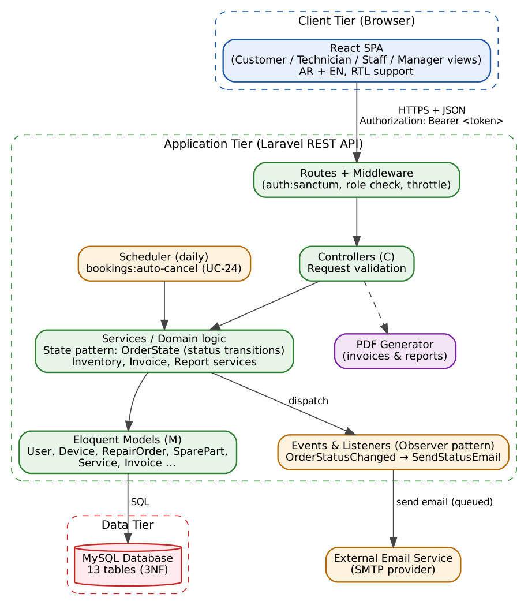

# Laptop Repair Shop Management System

Software Engineering course project (Track B: Website). A web system that registers every laptop entering a repair shop as a repair order and tracks it from booking or reception to delivery, with spare-part inventory, invoicing, and online status tracking for customers.

## Team

| Name | Role |
| --- | --- |
| Ahmad Muhammad Yasser Al-Zaro | Team Leader, backend |
| Taqi Al-Din Awad Abu Sarhan | Frontend |
| Muthanna Abdul Latif Al-Namoura | QA, documentation |

## Architecture

Three-tier client-server architecture with MVC in the application tier.

| Folder | Tier | Technology |
| --- | --- | --- |
| `frontend/` | Client (View) | React single-page application, Arabic and English |
| `backend/` | Application (Controllers, Services, Models) | Laravel REST API, Sanctum token auth |
| database | Data | MySQL, 13 tables (3NF) |
| `docs/` | Documentation | SRS, diagrams, API collection |

Design patterns: State (order status), Observer (status emails), layered services, SOLID.



## Planned repository structure

```
frontend/src/api          API client
frontend/src/components   shared UI components
frontend/src/pages        customer, technician, staff, manager, auth screens
frontend/src/routes       protected routes per role
frontend/src/i18n         ar.json, en.json
backend/app/Http          controllers and role middleware
backend/app/Models        Eloquent models
backend/app/Services      order, inventory, invoice, report services
backend/app/States        OrderState classes (State pattern)
backend/app/Events        OrderStatusChanged
backend/app/Listeners     SendStatusEmail (Observer pattern)
backend/app/Console       bookings:auto-cancel command
backend/database          migrations and seeders
backend/routes/api.php    43 REST endpoints (planned)
backend/tests             unit and feature tests
docs/                     SRS, diagrams, Postman collection
```

## Project links

- The English SRS is submitted separately for Phase 2.
- Jira board: [SCRUM backlog](https://taqio.atlassian.net/jira/software/projects/SCRUM/boards/1/backlog)

## Status

Phase 2: requirements, design and project setup. Implementation starts in Sprint 1 (see the Jira board).

## Planned setup after the Laravel and React projects are initialized

```
# backend
cd backend
composer install
cp .env.example .env
php artisan key:generate
php artisan migrate --seed
php artisan serve

# frontend
cd frontend
npm install
npm run dev
```
